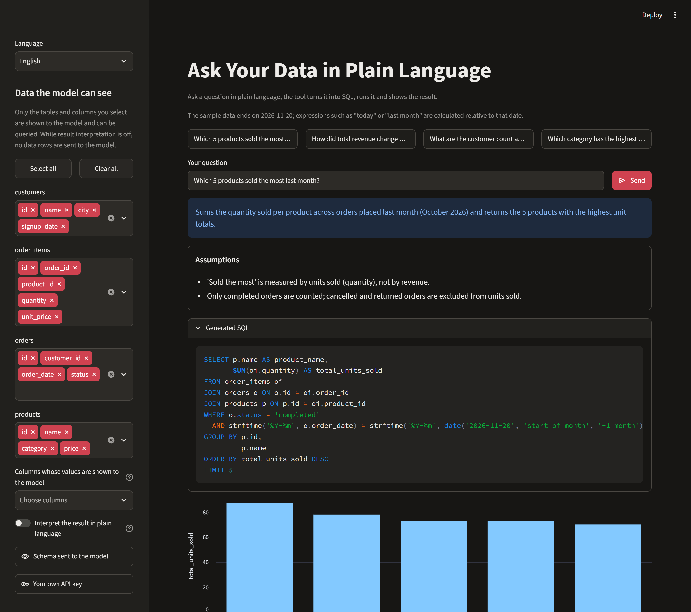

# Ask Your Data in Plain Language

A text-to-SQL tool. You ask a question in plain language (English or Turkish), Claude turns it into a SQLite query, the query runs read-only on a sample e-commerce database behind a column-level allowlist, and the result is shown as a table and a chart.

*Türkçe özet [aşağıda](#türkçe).*



## Highlights

- **Column-level allowlist.** The model only sees the schema of the columns the user selects. Generated SQL is checked in five layers (see [Security layers](#security-layers)).
- **Assumptions on screen.** If a question is ambiguous, the model states the decision it made ("only completed orders were counted") above the result.
- **Measured prompt changes.** Every prompt change is reported with before/after numbers; the prompt is never tuned against the holdout sets.
- **Bilingual.** English by default, Turkish selectable. Each language has its own sample database with the same numeric structure; the model answers in the language of the question.

## Evaluation results

Model `claude-sonnet-5-5`. Metric: execution accuracy (the generated SQL returns the same result as the reference SQL). Each question was asked 3 times unless noted.

| Set | Accuracy |
|---|---|
| Dev set, Turkish (20 questions × 3) | 60/60 |
| Dev set, English (20 questions × 3, `shop_en.db`) | 60/60 |
| Holdout v1, Turkish (20 × 3) | 53/60 (88.3%) |
| Holdout v2, Turkish (20 × 3, unseen while tuning) | 60/60 |

| Assumption behaviour | Dev (TR) | Dev (EN) | Holdout v2 |
|---|---|---|---|
| Clear questions: no unnecessary assumption | 38/39 | 39/39 | 9/18 |
| Ambiguous questions: decision stated | 21/21 | 20/21 | 42/42 |

- None of the 7 failed holdout v1 attempts is a SQL error: 4 return a correctly sorted full list instead of one row, 3 are a single question with two reasonable interpretations.
- The dev-set figure for unnecessary assumptions (~97%) does not generalize: on unseen holdout v2 questions it is about 50%. The remaining items are true but unnecessary (the model cannot see the data, so it cannot tell whether an interpretation would change the number).
- Translating the prompt to English did not change accuracy on the Turkish sets.
- Full history, including steps that were rolled back: [evals/RAPOR.md](evals/RAPOR.md) (Turkish).

## Security layers

The model never gets write access, and never sees columns the user did not allow.

1. **Schema allowlist.** Only the selected tables and columns are sent to the model as `CREATE TABLE` statements. All columns are selected when the page opens, so a visitor can try an example question right away; any table or column can be turned off. No data rows are sent while generating SQL. Optionally, the distinct values of low-cardinality columns (status, category) can be shown, capped at 20 values of 40 characters each.
2. **`validate_sql`.** Only a single `SELECT` (or `WITH ... SELECT`) is allowed; data-modifying keywords are rejected.
3. **`check_access`.** The SQL is parsed with [sqlglot](https://github.com/tobymao/sqlglot); aliases, subqueries and CTEs are resolved to real tables, and any table or column outside the allowlist is rejected by name. `SELECT *` and `table.*` are refused on tables with hidden columns.
4. **SQLite authorizer.** `set_authorizer` enforces the same allowlist inside the database at compile time, as a backstop for anything the parser misses.
5. **Read-only connection and timeout.** The database is opened in `mode=ro`; each query is stopped after 5 seconds (`NL2SQL_QUERY_TIMEOUT`).

Unauthorized access and timeouts are not retried; other SQL errors are sent back to the model once for a fix.

**Optional interpretation.** A second model call can explain the result in plain language. It is off by default because this is the only place where result rows reach the model: the first 50 rows plus a pandas-computed summary (min/max with row labels, mean, sum over all rows). The model must take rankings only from that summary, cell contents are marked as data, and the text is labelled as AI-generated.

## Setup

```bash
python -m venv .venv
source .venv/bin/activate        # Windows: .venv\Scripts\activate
pip install -r requirements.txt

export ANTHROPIC_API_KEY="sk-ant-..."   # Windows (PowerShell): $env:ANTHROPIC_API_KEY="sk-ant-..."
streamlit run app.py
```

The sample databases (`shop.db`, `shop_en.db`) are created on first run; `python seed_db.py` rebuilds both. Set `NL2SQL_MODEL` to try another model. "Today" is fixed to the last day of the sample data (2026-11-20), so "last month" always means October 2026.

### Public deployment

Anyone with the link can ask questions with the server's key, so there are three safeguards:

1. **Spending limit (the real safeguard).** Set a monthly limit on the key's workspace in the Anthropic Console.
2. **Daily call limit.** `NL2SQL_DAILY_LIMIT` caps the total model calls per day with the shared key, e.g. `100`. Every question, every automatic retry after a SQL error, and every interpretation uses one call; when no call is left, the retry is skipped and the first error is shown. Unset or `0` means no limit. The counter is in memory and resets on restart.
3. **Visitor's own key.** A visitor can enter their own key in the sidebar; their calls skip the daily limit. The key is kept only in that browser session.

On Streamlit Community Cloud, put `ANTHROPIC_API_KEY` and `NL2SQL_DAILY_LIMIT` in the app's Secrets as top-level keys. Never commit the key.

## Running the evaluation

```bash
python evals/run_evals.py --check-gold                   # no API: show reference results
python evals/run_evals.py --set questions --runs 3       # Turkish dev set
python evals/run_evals.py --set questions_en --runs 3    # English dev set (shop_en.db)
python evals/run_evals.py --set holdout_v2 --runs 3      # Turkish holdout
python evals/run_evals.py --only 13 15                   # selected questions only
```

Column names, column order and extra columns are ignored; row order matters only when the question asks for sorting. Decimals use a 0.5% relative tolerance; integers must match exactly. Ambiguous questions can list alternative reference SQLs (`kabul_edilen`). Results are saved as JSON under `evals/results/`.

## Files

| File | Purpose |
|---|---|
| `app.py` | Streamlit UI |
| `i18n.py` | All UI texts and error messages, English and Turkish |
| `nl2sql.py` | Core: schema, prompts, SQL generation, security checks, execution, interpretation |
| `seed_db.py` | Builds `shop.db` (Turkish) and `shop_en.db` (English) from the same seed |
| `charts.py` | Altair charts: bars in SQL order, chronological date axis |
| `quota.py` | Daily call counter for the shared key |
| `evals/` | Question sets (`questions`, `questions_en`, `holdout`, `holdout_v2`), runner and report |
| `test_*.py` | Tests; none of them need an API key (`python -m pytest -q`) |

---

## Türkçe

Doğal dille (Türkçe ya da İngilizce) sorulan soruyu Claude ile SQLite sorgusuna çevirir, örnek bir e-ticaret veritabanında salt-okunur çalıştırır ve sonucu tablo ve grafik olarak gösterir. Arayüz varsayılan olarak İngilizcedir; kenar çubuğunun en üstündeki seçiciden Türkçeye geçilir. Türkçe seçilince Türkçe veritabanı (`shop.db`) açılır.

- Model yalnızca kullanıcının seçtiği sütunların şemasını görür. Üretilen SQL beş katmanda denetlenir: izin listesi, `validate_sql`, sqlglot ile `check_access`, SQLite yetkilendiricisi, salt-okunur bağlantı ve süre sınırı.
- Belirsiz sorularda model verdiği kararı "Varsayımlar" başlığıyla sonucun üstünde yazar.
- Değerlendirme raporu, tüm ölçümler ve geri alınan adımlarla birlikte Türkçe: [evals/RAPOR.md](evals/RAPOR.md). Holdout sorusu yazım kılavuzu: [evals/HOLDOUT_KILAVUZU.md](evals/HOLDOUT_KILAVUZU.md).

Kurulum yukarıdaki "Setup" bölümündeki komutlarla yapılır.
